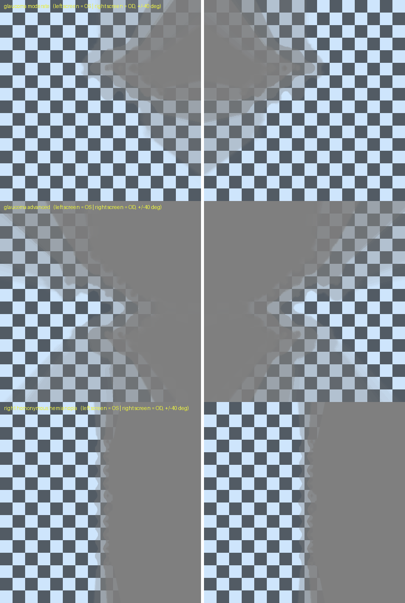

作成日: 20261116
最終更新日: 20261116

# HFA 視野シミュレータ VIVE Focus Vision 版（パススルー）

ハンフリー 30-2 の結果から、ゴーグルのカメラ映像（パススルー）で見ている**実際の周囲の景色**に、視野欠損を重ねて体験する Unity 用プログラムです。左の画面には左眼、右の画面には右眼のデータを別々に使います。Web版（`index.html`）と同じ76点・同じ補間・同じレベル分けを使い、ゴーグルの中で視野データの入力もできます。

Web版（スマホ用）とも、FOVE / HTC Vive 用の VR版（360度映像を使う別プログラム）とも独立しています。このフォルダだけで完結します。

**医療機器ではありません。** 理解促進・教育目的のツールで、診断・治療の根拠には使えません。表示は視線を固定した瞬間の見え方の再現で、実際の日常は眼球運動による代償でこれより良いことが多い点も、体験者に伝えてください。

**装着中は歩き回らせないでください。** 視野を覆った状態で実際の部屋を見るので、座った状態か、介助者がそばにいる状態で使ってください。

## 現状（必ず読んでください）

このプログラムは **実機でも Unity エディタでも、まだ一度も動かしていません。** 確認できたのは次の範囲です。

| 項目 | 状態 |
|---|---|
| プリセット9種×両眼の76点、補間グリッド（約11.6万値） | Web版と一致を確認 |
| C# スクリプト全体 | Unity 2021.3 の参照アセンブリでコンパイル通過 |
| パススルー開始（VIVE OpenXR / Wave）の呼び出し | HTC の API リファレンスと照合。その記載どおりの型を模した仮の定義でコンパイル通過（本物の SDK では未確認） |
| 新 Input System の分岐（視線・キーボード・マウス） | 仮の定義でコンパイル通過（本物のパッケージでは未確認） |
| 霧の位置の計算（上下・左右・左眼の反転・視線追従） | シェーダーと同じ式を別に計算して確認 |
| シェーダー2本 | **未コンパイル** |
| パススルーの表示、半透明の合成、視線追跡、左右の画面の判定、日本語の文字表示 | **未確認** |

セットアップの項目名と API は、HTC の開発者サイト（文末の「参照した資料」）で確認しました。ただし資料どおりに動くかは試していないので、画面と違う場合は実際の画面と HTC の手順を優先してください。最初に動かすときは、下の「初回の確認」を順に行ってください。

## できること・できないこと

| | この版（VIVE Focus Vision） | Web版（スマホ） | FOVE / Vive 版 |
|---|---|---|---|
| 見る景色 | 実際の周囲（パススルー） | スマホのカメラ映像 | 360度の写真・動画 |
| 欠損の表現 | **灰色の霧**（コントラスト低下） | ピクセル化＋ぼかし | ぼかし |
| 欠損の位置 | 視線に追従（内蔵アイトラッカー） | 画面中心に固定 | 視線に追従 |
| 左右の眼 | 左右の画面に別々 | 片眼ずつ、または良い方 | 左右の画面に別々 |

### なぜ「ぼかし」ではなく「霧」なのか

Web版と FOVE 版は、暗点を「黒」ではなく「ぼけて周囲に溶ける」ものとして表しています。ぼかすには映像の画素を読む必要がありますが、VIVE Focus Vision では**アプリからパススルー映像の画素を読む公開 API が見当たりません**。VIVE OpenXR プラグインの API リファレンスにあるパススルーの機能は、表示する層の作成・形・透明度・画質の設定だけです（HTC の開発者フォーラムでは、プライバシー上の理由で提供していないと説明されています）。アプリにできるのは、カメラ映像の上に半透明の絵を重ねることだけです。

そこで、欠損の程度に応じた濃さの**灰色の霧**を重ねます。軽度では景色のコントラストが下がり、視認不能（0 dB）では景色が完全に隠れます。黒塗りではありませんが、「周囲の色に溶ける」様子（補完現象）は再現できません。実際の暗点が灰色に見えるわけではないことを、体験者に伝えてください。霧の明るさは3段階で変えられるので、部屋の明るさに近いものを選ぶと不自然さが減ります。

| レベル | dB | 霧の濃さ |
|---|---|---|
| 0 | 25以上 | なし |
| 1 | 15〜24 | 35%（コントラストがやや下がる） |
| 2 | 5〜14 | 65% |
| 3 | 1〜4 | 90%（形はほぼ判別不能） |
| 4 | 0以下 | 100%（景色が隠れる） |

濃さは Inspector の `Veil Alpha` で変えられます。この値は見た目から決めた目安で、検証したものではありません。

## 構成

`HfaFocus` フォルダを Unity プロジェクトの `Assets` にコピーして使います。

| ファイル | 役割 |
|---|---|
| `Scripts/HfaFocusVive.cs` | **入口**。パススルーを開始する（SDK ごとの呼び出しはここだけ） |
| `Scripts/HfaFocusApp.cs` | 本体（表示・操作・保存） |
| `Scripts/HfaFocusPanel.cs` | ゴーグル内の入力パネル（76点とボタン） |
| `Scripts/HfaFocusGaze.cs` | 視線の取得（アイトラッカー / 頭の向き / マウス） |
| `Scripts/HfaField.cs` | 76点・プリセット・補間（Web版からの移植） |
| `Scripts/HfaStore.cs` | 視野データの保存と読み込み |
| `Resources/HfaFocusVeil.shader` | 霧を描くシェーダー |
| `Resources/HfaFocusUnlit.shader` | 入力パネル用の単色シェーダー |

すべて `HfaFocus` という namespace に入れてあるので、FOVE / Vive 用の `HfaVr` フォルダと同じプロジェクトに置いても名前は衝突しません。ただし FOVE は Windows、こちらは Android 向けのビルドになるので、**プロジェクトは分けることを勧めます**。レンダーパイプラインは Built-in を想定しています（URP では未確認）。

## セットアップ

HTC の「Getting Started with OpenXR」の手順でプロジェクトを作り、そこへこのプログラムを足します。項目名は HTC の資料の表記です。

### 必要な版（HTC の推奨）

| | 版 |
|---|---|
| VIVE OpenXR プラグイン | **2.5.1 以上**（パススルーの対応版） |
| Unity の OpenXR Plugin | 1.12.1 以上 |
| Unity | 2021.3.9f1 以上（Android Build Support つき） |
| Focus Vision の ROM | 7.0.999.308（プラグイン 2.5.1 の推奨） |

### 手順

1. Unity で 3D（Built-in）プロジェクトを作る
2. **VIVE OpenXR プラグインを入れる**: GitHub の `ViveSoftware/VIVE-OpenXR-Unity` の `Installer` から unitypackage を取得してインポートし、メニューの **VIVE > OpenXR Installer** で「Install or Update latest version」を押す
3. **File > Build Settings** で Android を選び、Switch Platform を押す
4. **Edit > Project Settings > Player** で次を設定する
   - Resolution and Presentation > Default Orientation を **Landscape Left**
   - Other Settings > Graphics APIs を **OpenGLES** だけにする（Vulkan を外す。項目が出なければ Auto Graphics API のチェックを外す）
5. **Edit > Project Settings > XR Plug-in Management** で **OpenXR** と **VIVE XR Support** feature group を有効にする。OpenXR Project Validation の画面が出たら **Fix All** を押す
6. **XR Plug-in Management > OpenXR** で次を有効にする
   - **VIVE XR Passthrough**（パススルー）
   - Interaction Profiles に **Eye Gaze Interaction Profile**（視線追跡）
   - Interaction Profiles に **VIVE Focus 3 Controller Interaction**（コントローラー。Focus Vision も同じ）
7. Hierarchy を右クリックし、**XR > Convert Main Camera to XR Rig** を選ぶ（カメラのタグが `MainCamera` であることを確認）
8. `HfaFocus` フォルダを `Assets` にコピーする
9. Player Settings の Scripting Define Symbols に **`HFA_VIVE_OPENXR`** を追加する
10. 空の GameObject を作り、**`HfaFocusVive`** を付ける
11. ゴーグルで **Settings > Developer options > USB debugging** を有効にし、USB でつないで Build And Run する
12. ゴーグル側の設定で、視線追跡を有効にして較正を済ませておく（設定の場所は HTC の資料では確認できていません）

カメラの背景色（透明な黒）と HDR の無効化は、起動時にスクリプトが設定します。HTC の資料でも、パススルーを下敷きにするときはカメラの Clear Flags を Solid Color、色を RGBA すべて 0 にするよう案内されています。ポストプロセスは使わないでください（画面のアルファが失われ、パススルーが見えなくなります）。

### 手順9でコンパイルエラーになる場合

パススルーを始める呼び出しは、HTC の資料の中でも2通りの形が載っています。

| 定義 | 対象 |
|---|---|
| `HFA_VIVE_OPENXR` | VIVE OpenXR プラグイン。**API リファレンスに載っている形**（`CreatePlanarPassthrough(out XrPassthroughHTC, LayerType, …)` が `XrResult` を返す）。まずこちらを試す |
| `HFA_VIVE_OPENXR_OLD` | VIVE OpenXR プラグイン。チュートリアルに載っている形（`int ID = CreatePlanarPassthrough(LayerType)`） |
| `HFA_WAVE` | VIVE Wave XR プラグイン（OpenXR ではなく Wave SDK で作る場合。`Interop.WVR_ShowPassthroughUnderlay(true)`） |
| （定義しない） | このプログラムからはパススルーを始めない |

どれもうまくいかなければ、**定義を外し、プラグインに付属するパススルー（Underlay／アンダーレイ）のサンプルスクリプトをシーンに置いてください。** このプログラムが必要とするのは「カメラの背景が透明」と「下敷きにカメラ映像がある」ことだけなので、同じように動きます。

## 操作

コントローラーだけで操作できます。

| 操作 | 動作 |
|---|---|
| 左コントローラーのメニューボタン、または B / Y | 入力パネルを開く・閉じる |
| A / X | 欠損表示のあり／なし（そのままの景色との見比べ） |
| パネルの点を指して引き金 | その点を今のレベルで塗る（引いたままなぞると連続で塗れる） |
| パネルのボタンを指して引き金 | そのボタンを押す |

入力パネルのボタン:

| ボタン | 動作 |
|---|---|
| 入力する眼 | 右眼（OD） ⇔ 左眼（OS） |
| 0〜4 | 塗るレベル（30 / 20 / 10 / 3 / 0 dB） |
| `<` `>` | プリセットを選ぶ |
| この眼に適用 ／ 両眼に適用 | 選んだプリセットを入れる |
| この眼をもう一方へコピー | 反転なしの複製 |
| この眼をリセット ／ 両眼をリセット | 正常視野に戻す |
| 表示 | 左右それぞれの眼 → 右眼のみ → 左眼のみ → 両眼の良い方 |
| 30度より外 | 外周の値を延長 ⇔ 加工しない |
| 欠損の位置 | 視線追跡 ⇔ 頭の向き（視線追跡なし） |
| 霧の明るさ | 暗め → 中間 → 明るめ |
| 視線の印 | 見ている場所に黄色い輪を出す（視線追跡の確認用） |
| 左右確認 | 左の画面を赤、右の画面を青に着色する |
| 半透明の合成 | 方式A ⇔ 方式B（下の「初回の確認」4 を参照） |

パネルは Web版と同じく、患者から見た向き（右眼なら左が鼻側）です。緑内障を両眼に入れるときは、コピーではなく「両眼に適用」を使ってください（左眼で左右反転します）。同名半盲は反転しません。

「表示」の「右眼のみ」は、**両方の画面に右眼のデータ**を出します（片方の画面を隠すわけではありません）。

Unity エディタでヘッドセットなしに再生したときは、マウスで指して左クリックが引き金、右ドラッグで見回し、M キーでパネル、X キーで欠損のあり／なしです。背景は黒になります。

### 視線追跡が使えないとき

視線は OpenXR の Eye Gaze Interaction Profile から読みます（XR の入力装置として読めなければ、HTC の資料が案内している Input System の `<EyeGaze>/pose` を試します）。

視線が取れない状態が続くと、自動的に頭の正面を視線とみなし、正面に黄色い＋印（固視目標）を出します。この状態では欠損が頭の向きに固定されるので、体験者には**＋印を見たまま、眼ではなく頭ごと動かして**周りを見てもらってください。「欠損の位置」ボタンで、はじめから頭の向きに固定することもできます。

## データの保存と Web版との関係

視野データは `Application.persistentDataPath` の `hfa-sim-data-v2.json` に保存されます（Android では通常 `Android/data/<パッケージ名>/files/`）。外部送信はありません。表示の設定（表示する眼、30度より外、霧の明るさなど）もゴーグル内に保存されます。

中身は Web版の localStorage（キー `hfa-sim-data-v2`）と同じ `{"od":[76個],"os":[76個]}` です。Web版には書き出し・読み込みのボタンがまだないため、現時点ではゴーグルの中で入力するか、ファイルを手作業で置くことになります。

## 初回の確認

1. **エディタで再生（ヘッドセットなし）**: Console にシェーダーのエラーが出ていないか。M でパネルが開き、76点が Web版と同じ並びで出るか。プリセットで緑内障中期を「両眼に適用」し、右眼の左上が暗い色になるか。パネルを閉じると、黒い背景の上に灰色の霧が出るか
2. **ゴーグルで起動**: 周囲の景色が見えるか。真っ黒なら、パススルーが始まっていません（「セットアップ」の手順6・9と、その下の表を確認。起動時の通知に失敗の理由が出ます）
3. **左右確認**: 左眼に赤、右眼に青が見えるか。逆や単色なら左右の判定が効いていないので、「表示」で「右眼のみ」「左眼のみ」を使ってください（その場合は連絡をください）
4. **半透明の合成**: 緑内障初期のような軽い欠損を入れ、霧の薄い部分を見る。景色より明るく白っぽく光って見える、または縁が暗く沈んで見えるなら、「半透明の合成」を切り替えて自然な方を選ぶ
5. **視線の印**: 見ている場所に黄色い輪がついてくるか。ついてこなければ、ゴーグル側の視線追跡の設定と較正を確認する
6. **緑内障中期を両眼に入れて「表示」を切替**: 「右眼のみ」で左上、「左眼のみ」で右上に霧が出るか
7. **頭を動かしたとき**に、霧がぶれたり遅れたりしないか
8. **文字**: パネルの日本語が□にならずに出るか

下の図は、シェーダーと同じ式を別に計算して作った見本です（左が左眼の画面、右が右眼の画面で、それぞれ上下左右±40度。市松模様は景色の代わり）。上から、緑内障 中期・緑内障 後期・右同名半盲を両眼に適用した場合です。実機でこのとおりに見えるかは未確認です。

- 緑内障: 左の画面は右上、右の画面は左上（どちらも鼻側上方）から霧が出る
- 右同名半盲: 両方の画面とも右半分に霧
- 30度より外へ放射状に伸びている部分は、「外周の値を延長」による推定です

## 既知の制限

- パススルー映像そのものが肉眼と違います（解像度、遅延、カメラと眼の位置のずれによる近くの物のゆがみ）
- 霧は一様な灰色です。周囲の色に溶ける補完現象は再現できません
- 視野30度より外は測定していません。既定の「外周の値を延長」は、同じ経線上の最外周と同じ程度と仮定した表示です（「加工しない」にすると30度より外はそのまま見えます）。ゴーグルの視界の大半は30度より外なので、説明の場面に合わせて選んでください
- 視線追跡の遅れとゆれは `Gaze Smoothing`（既定0.02秒）で調整します。大きくすると安定しますが、欠損が視線に遅れます
- 両眼の視線は1本（両眼を合わせた向き）として扱っています。斜視のある体験者では、眼ごとの欠損位置がずれます
- パススルーは OpenXR のセッションが破棄されると消えます。中断から戻ったときに始め直すようにしてありますが、それでも景色が出ない場合はアプリを起動し直してください
- 中心窩 dB の入力と 24-2 への切替には未対応です

## 開発者向け: 確認の手順

Unity と実機がない環境でも、次の3つは確認できます。Web版の値や式を変えたときは、1 を必ずやり直してください。

1. **値の照合**: `HfaField.cs` は UnityEngine に依存しないので、`mcs`（`apt-get install mono-mcs`）で単体コンパイルできます。Node で `index.html` から `STANDARD_POINTS`〜プリセットの部分を切り出して実行し、プリセット9種×両眼の76点と、右眼・左眼・両眼の補間グリッドを書き出して、`HfaField` の計算結果と比べます
2. **コンパイル確認**: NuGet の `UnityEngine.Modules`（2021.3.33、`api.nuget.org` から取得）の DLL を参照にして、`mcs -target:library` で `Scripts/*.cs` をコンパイルします。`HFA_VIVE_OPENXR` などの分岐は SDK がないので、API リファレンスの記載どおりの型を模した仮の定義を一緒にコンパイルして確かめます
3. **霧の位置**: `HfaFocusVeil.shader` と `FillMap` の式を別の言語で書き直し、上半視野欠損で上、右同名半盲で右、緑内障で鼻側上方（左眼は反転）に霧が出ること、視線を動かすと欠損が動くこと、頭を回しても画面内の位置が変わらないことを確かめます

20261116 の時点で、1 は約11.6万値が一致（差は小数4桁の丸めのみ）、2 は定義の組み合わせ8通りすべてで通過、3 は12項目すべて通過しました。シェーダーそのものはコンパイルできません。

## 参照した資料

HTC の開発者サイト（入口: https://developer.vive.com/resources/?site=jp ）のうち、20261116 に読んだページです。

| 内容 | ページ |
|---|---|
| プロジェクトの作り方 | https://developer.vive.com/resources/openxr/unity/tutorials/setup-and-installation/getting-started-with-openxr/ |
| プラグインの入れ方 | https://developer.vive.com/resources/openxr/unity/tutorials/setup-and-installation/how-to-install-vive-openxr-plugin/ |
| パススルー（チュートリアル） | https://developer.vive.com/resources/openxr/unity/tutorials/passthrough/ |
| パススルー（API リファレンス） | https://hub.vive.com/apidoc/api/VIVE.OpenXR.Passthrough.PassthroughAPI.html |
| 視線（Eye Gaze） | https://developer.vive.com/resources/openxr/unity/tutorials/getting-the-data-of-eye-gaze/ |
| コントローラー入力 | https://developer.vive.com/resources/openxr/unity/tutorials/basic-input-for-openxr/ |
| 対応機能と推奨バージョン | https://developer.vive.com/resources/openxr/unity/overview/ |
| うまく動かないとき | https://developer.vive.com/resources/openxr/unity/troubleshooting/ |
| Wave SDK のパススルー | https://hub.vive.com/storage/docs/en-us/UnityXR/UnityXRPassthrough.html |
